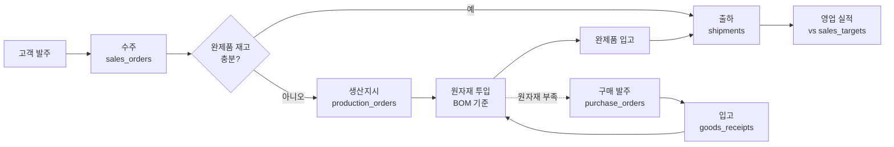
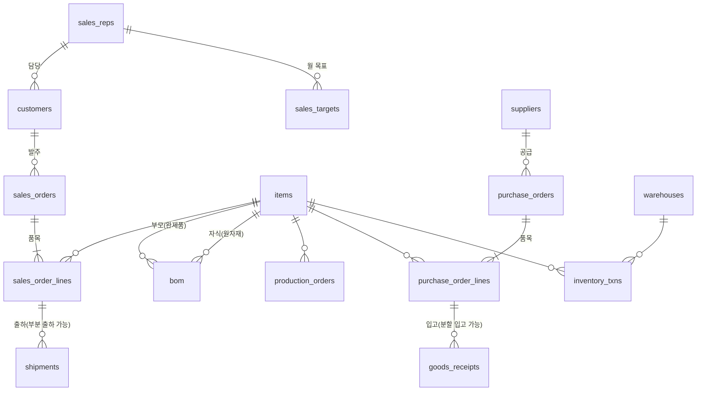

# Mini ERP — 제조사 영업·구매·생산·재고 DB 설계와 SQL 분석

가상의 전자부품 제조사(충북 청주 소재)를 가정하고, 수주부터 출하까지의 업무 흐름을 **PostgreSQL 데이터베이스로 설계**한 뒤 **2년치 거래 데이터를 SQL로 분석**한 프로젝트입니다.

> 모든 데이터는 `scripts/generate_data.py`로 생성한 **가상 데이터**입니다.
> 등장하는 회사명·인명은 실제와 무관하며, 분석을 위해 일부 패턴(공급업체 납기 지연, 정체 재고 등)을 의도적으로 설계했습니다.

| 항목 | 내용 |
| --- | --- |
| DB | PostgreSQL 16 (Supabase) |
| 데이터 생성 | Python (표준 라이브러리, seed 고정) |
| 규모 | 테이블 15개, 기간 2024-01 ~ 2025-12, 재고 수불 10,545건 |
| 분석 | SQL 분석 7개 (CTE, 윈도우 함수, 복합키 JOIN 등) |

---

## 1. 업무 흐름



SAP 모듈 기준으로 보면 영업(SD, O2C), 구매(MM, P2P), 생산(PP)의 기본 흐름을 포함합니다.

## 2. 데이터 모델 (ERD)



| 영역 | 테이블 | 대응 SAP 테이블 |
| --- | --- | --- |
| 기준정보 | `sales_reps`, `customers`, `items`, `warehouses`, `bom`, `suppliers` | KNA1, MARA, STKO/STPO, LFA1 |
| 영업 | `sales_orders`, `sales_order_lines`, `shipments`, `sales_targets` | VBAK, VBAP, LIKP/LIPS |
| 구매 | `purchase_orders`, `purchase_order_lines`, `goods_receipts` | EKKO, EKPO, MIGO 입고 |
| 생산·재고 | `production_orders`, `inventory_txns` | AFKO/AFPO, MSEG |

## 3. 설계 결정

**재고를 '현재고' 컬럼이 아닌 수불 원장으로 관리**
`inventory_txns`에 입고(+)·출고(−)를 모두 기록하고, 현재고는 `SUM(qty)`로 계산합니다. 모든 재고 변동의 이력과 원인 문서(`ref_type`, `ref_id`)가 남아 추적이 가능하고, 특정 시점의 재고도 누적합으로 다시 계산할 수 있습니다.

**헤더–품목 분리와 복합키**
수주·발주를 헤더와 품목으로 나누고, 품목은 `(order_id, line_no)` 복합 PK로 식별합니다. 출하·입고는 이 복합키를 FK로 참조하여 **부분 출하·분할 입고**를 표현합니다.

**무결성을 DB 제약조건으로 보장**
- 상태값·유형값은 `CHECK`로 허용 값만 입력 (예: 수주 상태 `OPEN / PARTIAL / SHIPPED / CANCELLED`)
- 재고 수불의 부호 규칙을 `CHECK`로 강제 (판매출고·생산투입은 음수, 구매입고·생산입고는 양수)
- 납기일 ≥ 주문일, BOM 자기참조 금지 등 업무 규칙을 `CHECK`로 정의
- 수주 삭제 시 품목만 `ON DELETE CASCADE`, 참조 중인 마스터 데이터는 삭제 차단

**의도적으로 FK를 걸지 않은 컬럼**
`inventory_txns.ref_id`는 출하·입고·생산지시 중 하나를 가리키는 다형 참조라 단일 FK로 묶을 수 없습니다. 대신 `ref_type`을 `CHECK`로 제한했습니다.

**FK 컬럼 인덱스**
PostgreSQL은 FK에 인덱스를 자동 생성하지 않으므로, 조인에 쓰이는 FK 컬럼에 인덱스를 직접 추가했습니다.

## 4. 가상 데이터 생성과 검증

`scripts/generate_data.py`는 영업일 단위로 하루씩 시뮬레이션합니다(입고 → 생산 완료 → 생산 착수 → 출하 → 재발주·생산계획 순). 주말·공휴일에는 거래가 없고, seed가 고정되어 있어 다시 실행해도 같은 데이터가 생성됩니다.

| 테이블 | 행 수 | 테이블 | 행 수 |
| --- | --- | --- | --- |
| sales_orders | 2,527 | purchase_orders | 995 |
| sales_order_lines | 4,749 | purchase_order_lines | 1,181 |
| shipments | 4,618 | goods_receipts | 1,331 |
| production_orders | 535 | inventory_txns | 10,545 |
| customers | 40 | suppliers | 15 |
| items (완제품 20 + 원자재 40) | 60 | bom | 149 |

적재 후 `sql/validate.sql`로 다음을 검증했습니다(모두 0건).
- 재고가 한 시점이라도 음수가 된 경우
- 출하 합계 > 수주 수량, 입고 합계 > 발주 수량
- 생산 투입량 ≠ BOM 소요량 × 생산 수량
- 출하일 ≤ 수주일, 주말 거래
- 수주 상태값과 실제 출하 내역의 불일치

> 실제로 Supabase 적재 중 `shipments` 테이블이 누락되어 상태 불일치 2,439건이 검출되었고, 재적재로 해결했습니다. 적재가 오류 없이 끝나도 데이터가 빠질 수 있어 검증 쿼리가 필요하다는 것을 확인한 사례입니다.

## 5. SQL 분석

| # | 질문 | 주요 기법 | 핵심 결과 |
| --- | --- | --- | --- |
| [01](analysis/01_daily_inventory_balance.sql) | OIS 액추에이터의 일자별 재고는? | CTE, `SUM() OVER` | 재고 0인 날 10일 (결품) |
| [02](analysis/02_supplier_on_time.sql) | 납기를 가장 못 지키는 공급업체는? | 3-table JOIN, `CASE`, `FILTER` | Shenzhen Hongda: 계약 21일 → 실제 평균 39일, 입고 100% 지연 |
| [03](analysis/03_monthly_revenue_yoy.sql) | 월 매출과 전년 동월 대비 성장률은? | 복합키 JOIN, `date_trunc`, `LAG` | 연 매출 69.1억 → 79.3억 (+14.7%) |
| [04](analysis/04_rep_target_achievement.sql) | 영업담당별 목표 달성률은? | 4-table JOIN, `LEFT JOIN`, `PARTITION BY` | 1명만 2년 연속 누적 80% 미만 |
| [05](analysis/05_item_abc_analysis.sql) | 매출 핵심 품목은? (ABC 분석) | `SUM() OVER ()`, 누적 비중 | 매출이 고르게 분산 → 70/90 기준 시 60%가 A등급 |
| [06](analysis/06_inventory_turnover.sql) | 재고가 과하게 쌓인 품목은? | `generate_series`, `CROSS JOIN`, `NULLIF` | FG-1019 기말재고 14.1개월분 |
| [07](analysis/07_stockout_root_cause.sql) | 납기 지연은 어디서 시작되었나? | CTE 체인, `BOOL_OR`, `EXISTS` | 공급업체 지연 → 생산 지연 → 고객 납기 지연 경로 확인 |

### 대표 분석: 07. 납기 지연 원인 추적

```
Hongda 입고 지연 (실제 39일, 100% 지연)
  → 모터 드라이버 IC·자이로 센서 IC 부족
  → 생산 착수 지연 (OIS 액추에이터: Hongda 자재 대기 지시 평균 19.5일 지연 vs 그 외 5.0일)
  → 고객 납기 지연 (Hongda 부품 사용 품목 7.1% vs 미사용 0.2%)
```

원자재의 공급업체 정보는 품목 마스터에 없기 때문에, 발주 이력에서 원자재–공급업체 관계를 도출해 BOM과 연결했습니다.

**한계:** 같은 Hongda 부품을 쓰는 FG-1011·FG-1012는 지연 출하율이 0~1.6%로 낮았습니다. 따라서 공급업체 의존은 위험 요인이지 지연의 유일한 원인은 아니라고 결론의 범위를 한정했습니다.

### 분석에서 얻은 점

- **지표 하나만으로 판단하지 않기:** 국내 공급업체도 지연율은 30~40%였지만 지연 규모는 평균 3~5일로, Hongda(평균 18일)와 성격이 달랐습니다. (02)
- **기준을 적용하기 전에 분포 확인하기:** 매출이 고르게 분산된 데이터에 ABC 70/90 기준을 그대로 적용하면 차등 관리의 의미가 사라집니다. (05)
- **연평균이 최근 변화를 가린다:** FG-1019는 연간 회전율로는 크게 튀지 않았지만, 최근 출고 대비 기말재고로 보면 정체가 뚜렷했습니다. (06)

## 6. 폴더 구조

```
├─ sql/
│  ├─ schema.sql        # 테이블·제약조건·인덱스 정의
│  ├─ post_load.sql     # CSV 적재 후 시퀀스 보정
│  └─ validate.sql      # 데이터 무결성 검증
├─ analysis/            # 분석 쿼리 01~07
├─ scripts/
│  └─ generate_data.py  # 가상 데이터 생성
└─ data/                # 생성된 CSV 15개
```

## 7. 실행 방법

1. `sql/schema.sql` 실행 → 테이블 15개 생성
2. `data/`의 CSV를 FK 순서대로 적재
   `sales_reps → customers → items → warehouses → bom → suppliers → sales_orders → sales_order_lines → shipments → sales_targets → purchase_orders → purchase_order_lines → goods_receipts → production_orders → inventory_txns`
3. `sql/post_load.sql` 실행 (자동 번호 보정)
4. `sql/validate.sql` 실행 → 모든 결과가 0인지 확인
5. `analysis/`의 쿼리 실행

데이터를 다시 만들려면 `python scripts/generate_data.py`를 실행합니다.

## 8. 다음 단계

- [ ] 리눅스 서버(Docker)에 PostgreSQL 직접 배포, 백업·복구 자동화, 권한 분리
- [ ] 영업 KPI 대시보드와 일일 리포트 자동화